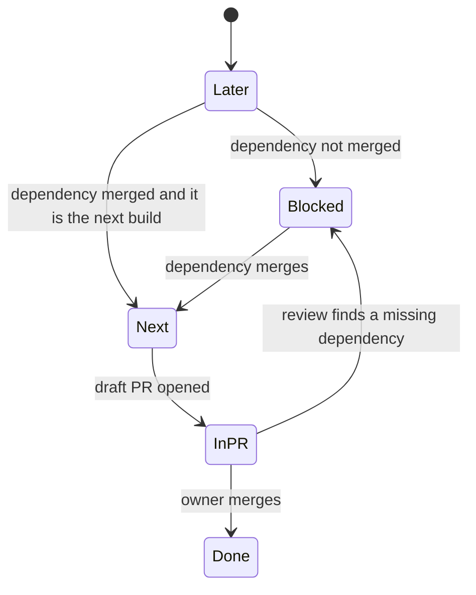
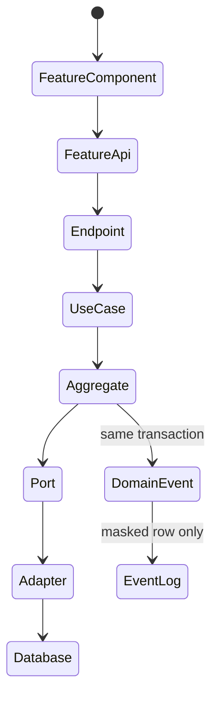

# Architecture consistency review

Answer: keep one Vite + React app and keep encrypted SQLite as the default store. Do not add microfrontends. Do not make Postgres the default. No accepted ADR changes. Two blockers are already the open security PR.

Reviewed `main` at `23c9245` plus open [PR 26](https://github.com/veeresh-bikkaneti/TrueBalance/pull/26) (`e4fb349`) and [PR 28](https://github.com/veeresh-bikkaneti/TrueBalance/pull/28) (`ca2b111`). Code lines below were opened in this pass. Seat UI returned the frontend rows. Seats API and DATA returned nothing and were stopped; those rows were checked again here. `[Tested]` means a file line. `[Inferred]` means a judgment, not a measurement.

## Findings

Sorted by severity. Prompt is the spec that should carry the fix.

| Id | Severity | Rule | Where | Evidence | Fix | Prompt | Review |
| --- | --- | --- | --- | --- | --- | --- | --- |
| F1 | Blocker | No secrets in the repo (`AGENTS.md` section 1; ADR 0004) | `OfflineCPA/src/Backend/Program.cs:16` and `OfflineCPA/docker-compose.yml:9` | `Password=secure_local_password` and `POSTGRES_PASSWORD: secure_local_password` | PR 26 already removes the fallback and requires `.env`. Merge that PR. | 02 | Accept |
| F2 | Blocker | Ports bind to loopback only (ADR 0004) | `OfflineCPA/docker-compose.yml:12`, `:28`, `:45` | `"5432:5432"`, `"8080:8080"`, `"3000:3000"` with no `127.0.0.1` | PR 26 publishes only `127.0.0.1:8080` and `127.0.0.1:3000` and does not publish `5432`. Merge that PR. | 02 | Accept |
| F3 | Should | Shell plus feature components, not one dashboard (ADR 0003, ADR 0011) | `OfflineCPA/frontend/src/App.tsx:28` | The only screen is `<Dashboard />`. No `src/shell/` or `src/features/`. | Add `src/shell/`, `src/features/<feature>/{api,components,routes,state,tests}`, and `src/ui/` in prompt 10. | 10 | Accept. Rejected as a Blocker: prompt 10 has not started, so this is planned work, not a broken P0 path. |
| F4 | Should | Feature API calls live with the feature (ADR 0003) | `OfflineCPA/frontend/src/components/Dashboard.tsx:2` and `:24` | `import axios from 'axios'` and `axios.get` of `/transactions`. Same file also calls `/export` (`:40`) and `/upload` (`:64`). | Move HTTP into `src/features/transactions/api`. No cross-feature imports exist yet. | 10 | Accept |
| F5 | Should | Import boundaries must be enforced (ADR 0011) | `OfflineCPA/frontend/package.json:28` | ESLint `^8.56.0` is installed. The next lines are `eslint-plugin-react-hooks` and `eslint-plugin-react-refresh` only. `eslint-plugin-import` and `eslint-plugin-boundaries` are absent. | Add the arena pick below when the feature folders land. | 10 | Accept. Rejected "new prompt": this fits prompt 10. |
| F6 | Should | Endpoints stay thin and call use cases (ADR 0003) | `OfflineCPA/src/Backend/Program.cs:48`, `:115`, `:122` | `/api/upload`, `/api/transactions`, and `/api/export` take `OfflineCPADbContext`. | Keep DbContext out of endpoints. PR 28's ledger routes already call use cases (`Program.cs:167` on that branch). | 04 | Accept |
| F7 | Should | Ports from ADR 0003 exist before adapters multiply | `OfflineCPA/src/Application/Application.csproj:4` | Application references Domain only. On main the interfaces are `ILocalFileParser` and `IChartOfAccountsSeeder`. Missing: `IStatementImporter`, `IDocumentVault`, `IReportExporter`, `INetworkGate`, `IAiAssist`. | Add the ports in prompt 04. `ILedgerStore` already exists on PR 28 (`Application/Interfaces/ILedgerStore.cs:5`). | 04 | Accept |
| F8 | Should | Architecture tests fail the build on a bad reference (ADR 0003, ADR 0011) | `origin/feat/ledger-core:OfflineCPA/tests` | `git grep` for `NetArch`, `ArchUnit`, or `Architecture` under that test tree found no files. | Add dependency-rule tests in the ledger follow-up on PR 28. | 03b (new, same PR) | Accept |
| F9 | Should | In-process domain events, not only an audit row (ADR 0011, ADR 0002) | `origin/feat/ledger-core:OfflineCPA/src/Domain/Entities/LedgerAuditRecord.cs:7` | Class is `LedgerAuditRecord`. `git grep IDomainEvent` on that branch printed no matches. `LedgerAction` includes `PeriodLocked`. There is no dispatcher type. | Add `IDomainEvent`, `EntryPosted`, `EntryReversed`, `PeriodLocked`, and an in-process dispatcher inside the same unit of work. | 03b | Accept |
| F10 | Should | Event rows are masked. No free-text descriptions (ADR 0011, ADR 0005) | `origin/feat/ledger-core:OfflineCPA/src/Domain/Entities/LedgerAuditRecord.cs:15` | `public string Details` is set from a caller-supplied string capped at 500 characters. | Store event type, entity id, local user id, time, and a masked summary only. | 03b | Accept |
| F11 | Should | SQLite remains possible (ADR 0006) | `OfflineCPA/src/Backend/Program.cs:19` and `Infrastructure.csproj:17` | `options.UseNpgsql(connectionString)` and `Npgsql.EntityFrameworkCore.PostgreSQL` 8.0.10. No `UseSqlite`. PR 28's ledger migration uses `uuid`, `timestamp with time zone`, and `LANGUAGE plpgsql`. | Keep Postgres as the dev adapter. Prompt 11 adds the encrypted SQLite adapter and replaces plpgsql-only guards. Do not change ADR 0006. | 11 | Accept |
| F12 | Should | Tax lines are versioned data, not an enum (ADR 0007) | `OfflineCPA/src/Domain/Enums/TaxLineItem.cs:3` | `public enum TaxLineItem` | Replace with per-year map files. | 07 | Accept |
| F13 | Should | Do not drop ledger rows that can exist (ADR 0002) | `origin/feat/ledger-core:OfflineCPA/src/Infrastructure/Migrations/20261125000000_LedgerCore.cs:22` | `migrationBuilder.DropTable(name: "JournalEntries")`. On main, seed only calls `_db.Accounts.Add` (`JsonChartOfAccountsSeeder.cs:68`). Upload creates a `Transaction` (`Program.cs:73`), not a `JournalEntry`. | No app path on main inserts `JournalEntries`, so a seed-only install has no rows to keep. Say that in the migration comment and in `docs/ledger.md` during 03b. Do not invent a data migration. | 03b | Accept |
| F14 | Should | A journal entry is balanced lines, not one signed amount (ADR 0002) | `OfflineCPA/src/Domain/Entities/JournalEntry.cs:13` | `public decimal Amount` with the comment "Positive for Debit, Negative for Credit". | PR 28 replaces this shape with a header plus `Postings`. Finish that on PR 28. | 03 | Accept |
| F15 | Nice | UI state stays local until a feature needs more (ADR 0003) | `Dashboard.tsx:16` | `useState` only. No second state library in `package.json`. | Keep `useState` in each feature `state/` folder. | 10 | Accept |
| F16 | Nice | One frontend toolchain (ADR 0011) | `OfflineCPA/frontend/package.json:18` and `:32` | `"react": "^18.2.0"`, `"vite": "^5.1.0"`. Declared ranges, not a resolved lockfile. | Do not add a second bundler. React 18 and Vite 5 are the ranges in this file. | 10 | Accept |
| F17 | Nice | Product name in the shell | `OfflineCPA/frontend/src/App.tsx:13` | The sidebar text is `OfflineCPA`. | Rename when the shell is built. | 10 | Accept |

Rejected as written: Seat UI marked the missing shell and the missing wizard as Blockers. Both are prompt 10 work. The approved mockup is `docs/mockups/setup-wizard.html`. No wizard component exists. That is Should, already covered by F3.

`Program.cs` overlap: PR 26 and PR 28 both edit `OfflineCPA/src/Backend/Program.cs`. PR 26 replaces the connection-string fallback at main lines 14-16 and rewrites `/api/upload` from line 48. PR 28 inserts ledger service registration after the seeder (main line 24) and appends `/api/ledger/...` after `/api/export`. The using list and the service-registration block will conflict. Whichever PR merges second needs GitHub's "Update branch". Do not merge them in git from an agent.

## Arena: frontend shape

| Criterion | (a) One Vite + React app, feature folders, import lint | (b) Runtime microfrontends |
| --- | --- | --- |
| Offline single install | Pass. One bundle. | Fail. A host plus remotes at runtime. |
| One maintainer | Pass. | Fail. More repos and version skew. |
| Bundle size | Pass. One module graph. | Fail. Shared libraries are easy to ship twice. |
| Test cost | Pass. One runner. Cypress already exists (`frontend/package.json:12`). | Fail. A contract test per remote. |
| Later split | Pass if the import rules exist. | Pass only if you pay that cost now. |

Pick (a). ADR 0011 already says one React app and no microfrontends. The folder rules are what would make a later split possible. No Proposed ADR.

Import-lint arena, both MIT, both confirmed from the license file text on 2026-11-25:

- `eslint-plugin-import` rule `no-restricted-paths`. License: MIT. [eslint-plugin-import LICENSE](https://github.com/import-js/eslint-plugin-import/blob/main/LICENSE) [Confidence: High | Vote: 1/1 primary].
- `eslint-plugin-boundaries`. License: MIT. [eslint-plugin-boundaries LICENSE](https://github.com/javierbrea/eslint-plugin-boundaries/blob/master/LICENSE) [Confidence: High | Vote: 1/1 primary].

Pick `eslint-plugin-import` / `no-restricted-paths`. It is one zone list on the ESLint 8 config already in the repo. `eslint-plugin-boundaries` is the stronger model and is not needed until a feature has more than one public entry.

Boundary rules to enforce in prompt 10:

- `src/features/<A>` may import `src/ui` and `src/shell` public types. It may not import `src/features/<B>`.
- `src/ui` may not import `src/features` or `src/shell`.
- `src/shell` may import a feature's route entry only, not its `state/` or `api/` files.
- No `import()` from a remote URL. One origin, the local app.

## Arena: database default

| Criterion | SQLite default, Postgres optional (ADR 0006) | Postgres default |
| --- | --- | --- |
| Offline single install | Pass. One encrypted file. | Fail. A database server on the user's machine. |
| One maintainer | Pass. | Fail. Compose and upgrades become the product. |
| One-command install (prompt 11) | Pass. This is what TB-11 promises. | Fail. Prompt 11 would have to be rewritten. |
| Code today | Fail. Npgsql 8.0.10 only (`Infrastructure.csproj:17`). | Pass for the dev compose file. |
| Books that outgrow one file | Fail. | Pass. |

Pick SQLite as the default and Postgres as an `ILedgerStore` adapter. Reason: the user is one person on one computer (ADR 0006, ADR 0011). Making Postgres the default would throw away the one-command install. No Proposed ADR. Prompt 11 still needs Veeresh to approve the encryption library. Dev compose can stay on Postgres until that prompt.

## What scale means here

No file in this repo measures a user's volume. These figures are `[Inferred]`.

- Records per year: a household is on the order of hundreds to a few thousand postings. A small sole proprietor is on the order of a few thousand to a few tens of thousands. `[Inferred]`
- File size: that volume in one SQLite file is tens of megabytes, not a server-sized database. That is the store ADR 0006 is for. `[Inferred]`
- Report time: a year report that sums posted lines at that volume should finish in under a second on a laptop. Not timed in this review. `[Inferred]`

Scale here means more years and more accounts in one file, not more services. A hosted multi-user system is a new ADR, which ADR 0011 already requires.

## Statecharts

Feature life on the board:

One request through the layers, after prompts 03, 04, and 10:

## EDA check

ADR 0011 allows in-process events and an append-only log. No broker. PR 28 matches the "no broker" half and the append-only half: `TR_LedgerAuditRecords_AppendOnly` raises on update or delete (`20261125000000_LedgerCore.cs`, plpgsql function). It does not match the event half (F9, F10). Prompt 03b is the fix, on PR 28, not a new PR. Nothing in this review writes that code.
