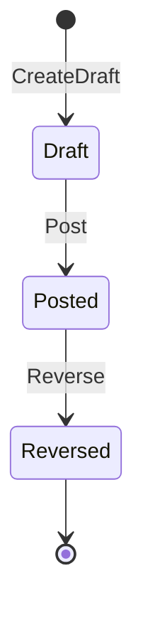

# Ledger core (TB-03)

Recordkeeping support only, not tax or legal advice.

This page describes the double-entry ledger added in PR TB-03: entry states, the
signed-amount choice, the balance rule, the period lock, and what guards posted
history in the database.

## Entry states

| From | To | Action | Allowed only if |
| --- | --- | --- | --- |
| (none) | Draft | `CreateDraft` | memo is non-empty (max 500 characters); the date falls inside the period; the period is not locked; at least one posting |
| Draft | Posted | `Post` | at least two postings; postings sum to exactly `0.00`; the period matches the entry; the period is not locked |
| Posted | Reversed | `Reverse` | the entry has not been reversed already; the reversal period is not locked; the reversal date falls inside the reversal period |
| Reversed | none | none | terminal state |

`Reverse` does not edit the original postings. It creates a second entry in the
`Posted` state whose postings are the negation of the original's. The two entries
point at each other (`ReversesEntryId` on the new entry, `ReversedByEntryId` on
the original). A reversing entry is itself `Posted` and can be reversed once.

Every violation throws `LedgerRuleException`, which the API returns as a 400 with
the message in `error`.

## Signed amounts

Each posting holds one `decimal Amount` in `numeric(18,2)`. A positive amount is
a debit and a negative amount is a credit. There is no separate side column.

An entry balances when the sum of its posting amounts is exactly zero. The same
sum over every account is zero at all times, so the ledger carries one invariant
instead of two columns that must agree.

The arena vote adopted this from the plain-text ledger tools (Ledger, hledger,
Beancount), which all store signed postings (`docs/research/r1-competitor-research.md`,
comparison matrix row "1. Double-entry ledger", Part 2, line 104). The ranked-ideas
table lists immutable posted entries and formal reversals as idea #1 (line 140);
the signed-posting layout is how this PR implements that idea. Amounts with more
than two decimal places, and zero amounts, are rejected at the boundary rather than
rounded.

## Balance rule

An account balance is the sum of posting amounts across entries whose status is
`Posted` or `Reversed`. Draft entries are excluded.

A `Reversed` entry still counts because its postings are kept as history, and the
reversing entry holds the negated postings. The original and the reversal cancel
only if both are summed. Counting `Posted` alone would drop the original and keep
the reversal, which shifts the account by the reversed amount. In code this is
`JournalEntry.IsInLedger`, and `EfLedgerStore.GetAccountBalancesAsync` applies the
same filter.

## Period lock

Every entry belongs to one period (`Periods`: name, start date, end date, locked
flag). Locking a period is permanent in the domain: `Lock` on a locked period
throws, and no unlock operation exists.

- A draft cannot be created in a locked period.
- A draft in a period that was locked afterwards cannot be posted.
- A reversal cannot be posted into a locked period. The reversal date selects its
  own period, which may differ from the original's. This is how a locked year is
  corrected from an open one.

Locking writes a `PeriodLocked` audit record.

## Audit records

`LedgerAuditRecords` holds one row per create, post, reverse and lock: time, local
user id, action, entry id, period id and a short detail string (max 500). It holds
no names or e-mail addresses. Until a later prompt adds authentication, the API
records every action under the constant user `local`.

## Database guard

Migration `20261125000000_LedgerCore` adds three triggers. They are a second line
behind the domain rules, for writes that bypass the application.

| Trigger (function) | Table | Behavior |
| --- | --- | --- |
| `TR_Postings_Immutable` (`Fn_Postings_Immutable`) | `Postings` | UPDATE or DELETE raises when the parent entry's `Status` is not 0 (also when an UPDATE moves a posting into a non-draft entry) |
| `TR_JournalEntries_Immutable` (`Fn_JournalEntries_Immutable`) | `JournalEntries` | DELETE always raises; UPDATE raises if `Date`, `Memo` or `PeriodId` change while `Status` is not 0; `Status`, `PostedAtUtc` and `ReversedByEntryId` can still change, so 0 to 1 and 1 to 2 work |
| `TR_LedgerAuditRecords_AppendOnly` (`Fn_LedgerAuditRecords_AppendOnly`) | `LedgerAuditRecords` | every UPDATE and DELETE raises |

Limits of the guard:

- The triggers do not stop INSERT into `Postings`, and they do not check that
  postings balance. Those rules live in the domain.
- A superuser can drop the triggers.
- The triggers are verified by inspection only. CI runs no PostgreSQL service, so
  no automated test executes them. The migration was written by hand because no
  database was available to run `dotnet ef migrations add`; the model snapshot
  was edited to match. Run the migration against a scratch PostgreSQL before
  relying on it.
